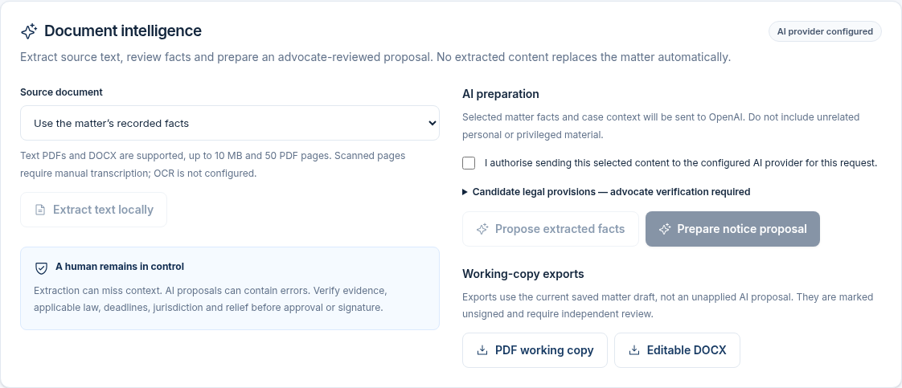
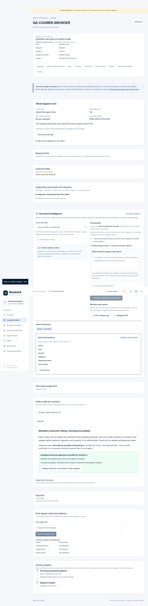
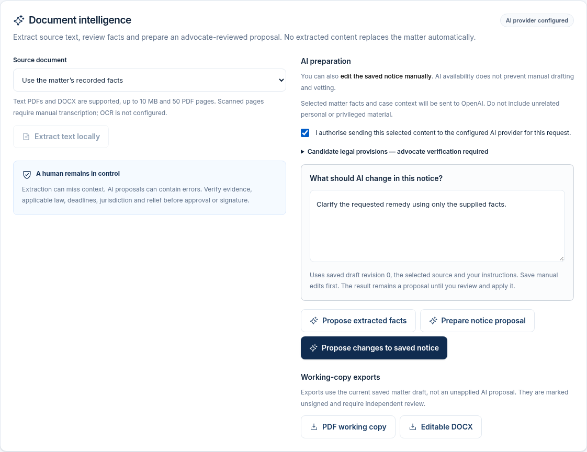
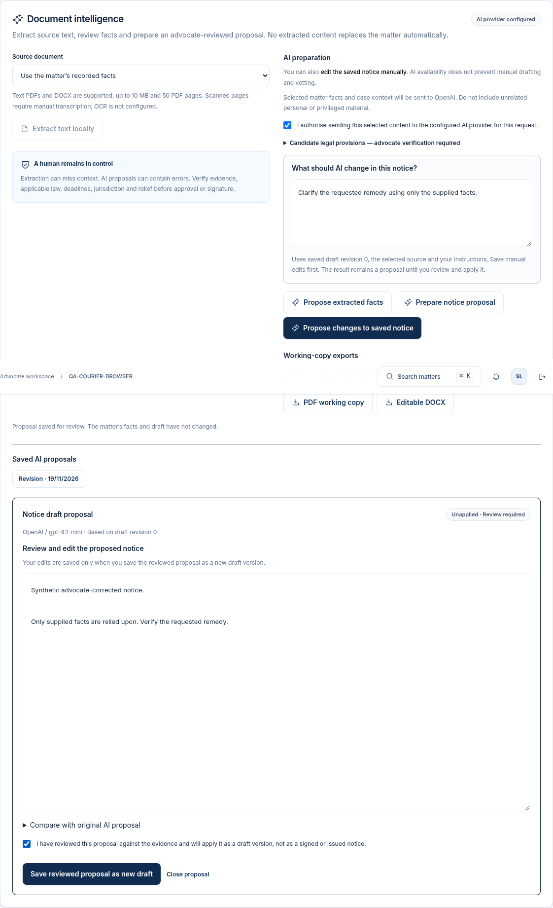
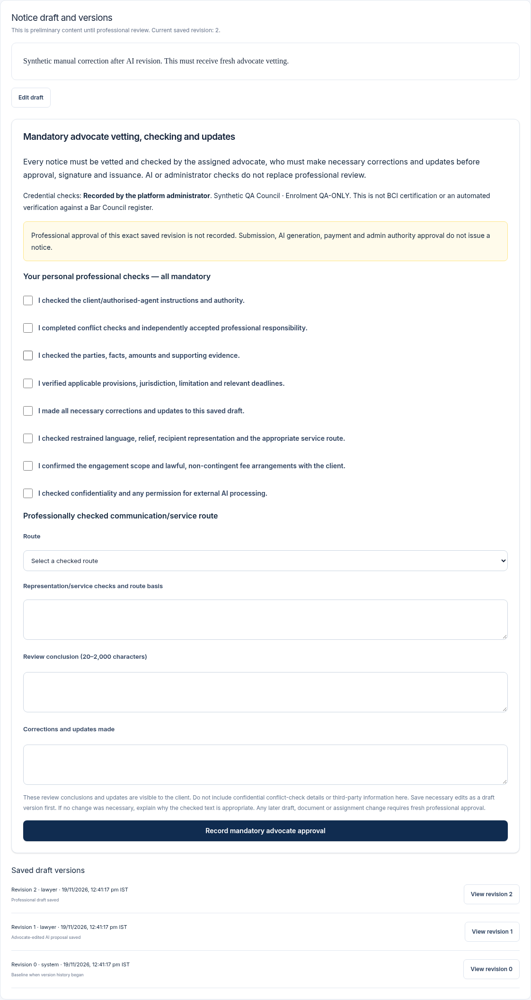
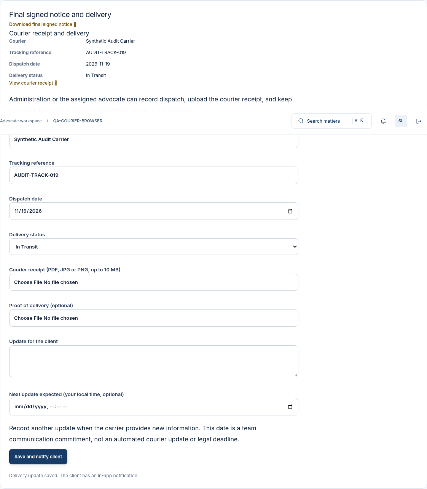
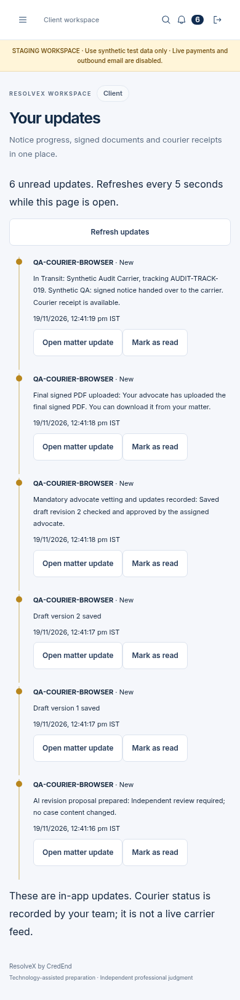
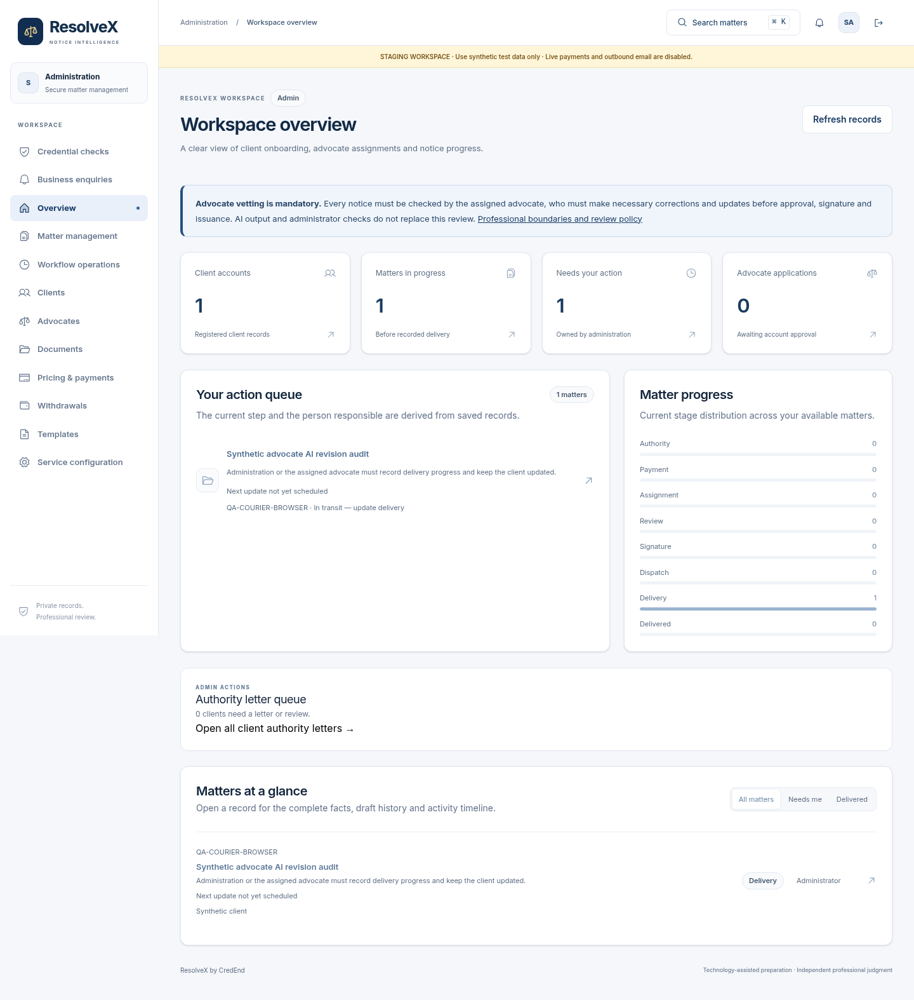
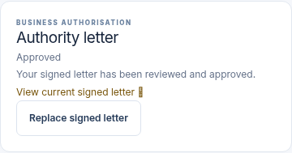

# Notice workflow audit and fixes — 19 November 2026

The scope is the existing development Notice AI / ResolveX request-to-delivery
workflow, with extra attention to advocate AI revisions, manual editing, approval
invalidation, private documents, client handoff and role dashboards. This is an
implementation and workflow audit, not a legal opinion or an exhaustive security
certification. Production data, deployments, DNS, credentials and `main` were not
changed. All screenshots below were captured and inspected during this audit
with synthetic records on an isolated loopback-only test database.

## Findings fixed

| Severity | Finding and evidence | Result |
| --- | --- | --- |
| Critical | Draft proposals acquired an empty `facts` subdocument from Mongoose defaults. The UI used its truthiness and displayed empty fact lists instead of the notice and apply controls. The browser reproduced this after a successful API response. | The UI branches on the explicit artifact kind. Draft text, editable proposal and review/apply controls now work. |
| High | AI generation omitted the current saved notice and had no targeted change instructions. | The assigned advocate can request a revision using the saved draft, selected matter evidence and explicit change instructions. Verified payment, matching revision and consent are enforced. |
| High | A readable file from a different matter could be submitted as evidence. | AI evidence must be attached to the selected matter, including its scoped document-response history. |
| High | Applying AI while a manual editor was open could overwrite unsaved local work. | Draft generation/application is disabled until current manual edits are saved or cancelled. Browser verification exercised this guard. |
| Medium | Proposals could not be corrected before applying, and the UI always described them as unapplied afterward. | Advocates can edit proposals before saving. Original AI output remains intact; the saved version records its artifact source and advocate edits. Applied revision metadata is committed with the draft and reflected in the UI. |
| Medium | A successful save followed by a refresh failure could look like a failed write. | The UI marks the proposal applied immediately after save and distinguishes a later refresh failure. |
| Medium | Invalid provider JSON/response shapes could become generic server errors. | They produce explicit provider errors without applying a draft. |
| Medium | Approved/pending authority letters still displayed instructions and an upload control, implying another upload was necessary. | Replacement is an explicit action; approved/pending copies stay visible without another upload prompt. |
| Low | Dashboard action, next-update and client descriptions ran together in the initial admin screenshot. | Each description is displayed on its own line. |

## Steps and current health

1. **Intake, authority, payment and assignment — regression checks pass.**
   Existing isolated tests cover saved requests, ownership, authority submission/
   review retries, verified payment, replayed callbacks and administration-only
   assignment. Unpaid matters cannot be assigned. The browser checked approved
   authority state and its explicit replacement/cancel controls. Live payment
   transport was not exercised.
2. **Targeted AI revision — fixed and browser/API verified.** The advocate
   supplies instructions for the current saved revision. Current draft and
   evidence are sent to the configured provider only with consent. Generation
   creates a separate proposal; it does not silently overwrite the notice.
3. **Advocate corrections and version history — verified.** The advocate edits
   the proposal, confirms review, saves revision 1, then manually edits the notice
   and saves revision 2. History preserves the baseline, AI-associated version
   and manual version. Unsaved manual edits block AI application.
4. **Mandatory professional review and signing — verified.** An AI/manual edit
   resets status to pending. Old approval cannot authorise the new revision.
   The advocate records all vetting checks for revision 2 before uploading the
   signed PDF. Signed notices reject further AI revision requests.
5. **Courier and delivery handoff — verified.** The assigned advocate uploads
   a courier receipt and records real delivery information. Administration sees
   the delivery action in its queue. Regression tests cover receipt history,
   unrelated-account denial, stale writes and transaction rollback.
6. **Client notifications and private downloads — verified.** The client sees
   revision, review, signed-file and courier updates, follows the exact matter
   link, and downloads the signed PDF and receipt. Unread updates are refreshed
   through the existing five-second visible-tab poll; this is not WebSocket push
   or a closed-browser email/SMS service.
7. **Role presentation and mobile accessibility checks — verified within scope.**
   Fresh advocate/admin/client captures show consistent white/navy cards,
   labelled controls, explicit next actions and readable dashboard rows. The
   390 px notification layout has no horizontal overflow; the completed browser
   journey had no JavaScript exceptions. Full keyboard, screen-reader,
   contrast and physical-device certification are not claimed.

## Screenshot evidence

### Initial AI controls and missing revision entry point

### Reproduced draft-as-facts defect

The “Notice draft proposal” panel incorrectly contained empty fact headings and
no notice editor. The full-page capture also includes fixed navigation at its
capture position; that stitching effect is not treated as a product layout bug.

### Targeted revision request

### Editable AI proposal and explicit review

### New version requires fresh vetting

### Signed file and courier receipt

### Client updates on mobile

### Admin delivery queue after corrections

### Approved authority state without a repeat-upload prompt

The initial draft, admin and client captures remain alongside these images for
comparison. The browser step result is in `audit-2026-11-19/browser-checks.json`.

## Validation and limits

- 68 automated checks pass: 18 unit tests and 25 integration tests with each of
  filesystem and GridFS storage. TypeScript and the Vercel build pass.
- New checks cover the current-draft revision payload, advocate-edited proposal,
  preserved original output, version provenance, client visibility boundaries,
  re-vetting before signing, signed-state protection, cross-matter evidence
  rejection and malformed provider responses.
- AI responses were mocked with synthetic content for deterministic API and
  browser tests. No real provider key was used or external AI request made.
  This verifies integration/workflow behavior, not generated legal quality.
- The production dependency audit reported two low-severity advisories in the
  Quill/react-quill-new dependency chain, and no moderate/high/critical advisories.
  They remain open; an audit-fix downgrade was not applied blindly. Existing
  server-side sanitization and client rendering sanitization remain enforced.
- Real AI requires a configured provider key and the AI enable flag. Existing
  production flags were not enabled. Live PayU/email, provider sandbox UAT,
  production load, current-law research, complete accessibility assessment and
  independent Indian advocate review of the commercial/BCI model remain open.
- The full portal was not freshly visually exercised in every possible legacy
  CRUD screen. Claims here are limited to the enumerated journeys and existing
  regression coverage. No guarantee of a completely bug-free system is made.
